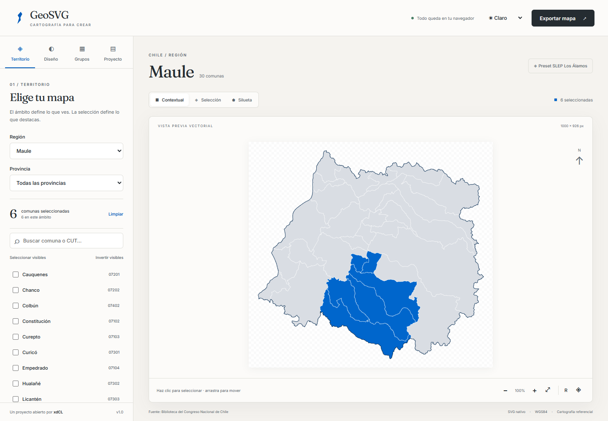

# GeoSVG

Editor cartográfico vectorial de Chile, abierto y desarrollado por **xdCL**. Selecciona comunas, diseña paletas HEX, crea grupos y exporta mapas SVG editables o PNG, completamente desde el navegador.

Repositorio: [xdCL/GeoSVG](https://github.com/xdCL/GeoSVG). URL de publicación: [GeoSVG en GitHub Pages](https://xdcl.github.io/GeoSVG/).



## Cobertura verificable

El catálogo contiene **16 regiones, 56 provincias y 346 comunas**. La capa distribuida de BCN ofrece geometría para **345 comunas**. Antártica (`12202`) figura en el catálogo como no disponible y no puede seleccionarse en el editor. El registro adicional “Zona sin demarcar” de la fuente no cuenta como comuna; se conserva en `public/data/reference.geojson`, fuera de la representación administrativa.

La Región del Maule tiene sus 30 comunas con geometrías reales. El preset **Territorio SLEP Los Álamos** selecciona exactamente Linares, Colbún, Parral, Retiro, Longaví, Villa Alegre y Yerbas Buenas mediante los CUT de la capa oficial.

Fuente: [Biblioteca del Congreso Nacional de Chile](https://www.bcn.cl/siit/mapas_vectoriales/), `comunas_final.zip / comunas.shp`. La página declara ediciones 2014, 2017 y diciembre de 2018; el XML fue creado en octubre de 2019. Fecha de consulta: **10 de octubre de 2026**. No se afirma vigencia cartográfica de 2026. Los detalles, hash de descarga, reparaciones, CRS y transformaciones se registran en `public/data/source.json`.

## Requisitos y ejecución

- Node.js 22 o superior; se recomienda Node.js 24.
- npm y un navegador moderno con SVG, Canvas, Web Workers y localStorage.
- Chrome instalado para las pruebas locales por defecto, o Chromium de Playwright usando `CI=1`.

```sh
npm ci
npm run dev
```

Abre la URL que imprime Vite, normalmente `http://127.0.0.1:5173/`.

```sh
npm run build       # TypeScript estricto + producción en dist/
npm run preview     # servir el build de producción
npm run test        # pruebas unitarias Vitest
npm run test:e2e    # navegador: escritorio y móvil emulado
npm run data:validate
npm run check       # datos + unitarias + build
```

Las geometrías procesadas están incluidas: no hace falta descargar ni instalar herramientas GIS para desarrollar la interfaz o compilar. `npm run data:import` se utiliza para actualizar la capa, no durante el despliegue.

## Uso

1. Elige **Región** y opcionalmente **Provincia**. Chile muestra el ámbito nacional, incluyendo las islas presentes en la fuente en su posición real.
2. Busca por nombre o CUT. La búsqueda ignora tildes y espacios exteriores. Marca checkboxes o activa los polígonos con clic, Enter o espacio. La selección global se conserva al cambiar de región.
3. Usa **Seleccionar visibles**, **Invertir visibles** o **Limpiar**. La búsqueda restringe qué comunas afectan los dos primeros controles. El contador distingue selección global y selección dentro del ámbito.
4. Elige **Contextual** para ver el ámbito completo, **Selección** para mostrar solo las comunas seleccionadas dentro del ámbito, o **Silueta** para unirlas y eliminar sus fronteras internas.
5. En **Diseño**, modifica los siete colores con el selector visual o campos `#RRGGBB`. Los valores inválidos no reemplazan el último color válido. Puedes copiar HEX, restablecer colores y controlar opacidad, fondo, límites, margen, etiquetas y leyenda.
6. Arrastra el mapa para desplazarlo, usa rueda o botones para zoom y ajusta la vista al ámbito o a la selección. En móviles el panel se abre con **Editar mapa** y la exportación permanece en la barra superior.

La aplicación ofrece las paletas Institucional, Wikimedia, Monocromática y Editorial. En **Mis paletas** puedes guardar la configuración cromática actual, renombrarla, duplicarla, eliminarla e importar/exportar JSON. Se almacenan en este navegador.

En **Grupos**, crea un grupo con nombre y HEX; selecciona comunas y pulsa **Asignar selección a este grupo**. Reasignar elimina esas comunas de los demás grupos. Puedes reordenar, renombrar o eliminar grupos y quitar de ellos las comunas seleccionadas. Prioridad cromática: grupo, color de selección, color del resto. La silueta unificada utiliza el color general de selección.

En **Proyecto**, aplica los presets SLEP, Mapa vacío o Territorio completo; guarda presets personales y exporta/importa el proyecto JSON. Ese proyecto incluye selección, grupos, diseño, tema y configuración de exportación. Las paletas personales se exportan desde Diseño. Restablecer la aplicación pide una confirmación concreta porque elimina la biblioteca local.

El tema puede ser claro, oscuro o automático. Las fuentes Fraunces e Inter se distribuyen localmente con sus licencias; no se requieren fuentes de servicios externos.

En **Diseño → Nombres y tipografía**, elige **Sin nombres**, **Solo seleccionadas** o **Todas las visibles**. Puedes usar [Inter](https://fonts.google.com/specimen/Inter) o [Fraunces](https://fonts.google.com/specimen/Fraunces), ambas del catálogo Google Fonts; también se conserva Arial para proyectos anteriores. La fuente se aplica a los nombres y a la leyenda, y se guarda en proyectos y presets. Puedes cambiar tamaño, color y ocultamiento de nombres superpuestos. Los proyectos nuevos usan Inter; los archivos antiguos conservan Arial.

## Exportación

Pulsa **Exportar mapa**. Configura ancho, proporción automática, 1:1, 4:5, 16:9, A4 o dimensiones personalizadas. Los formatos ajustan el territorio dentro de márgenes sin estirarlo.

- **SVG:** paths vectoriales independientes identificados por CUT, elementos `title`, metadatos de fuente, colores exactos, fondo opcional, nombres y leyenda. No incluye scripts, imágenes raster sustitutivas ni CSS externo. Editable en Inkscape o Illustrator. En Silueta se exporta una unión topológica real.
- **PNG:** rasteriza ese mismo SVG en Canvas a 1×, 2× o 4×, conservando transparencia, colores y proporción. Existe un límite visible de 64 megapíxeles y 16.000 px por lado.

Cuando hay nombres o leyenda, el SVG incluye el archivo WOFF2 de Inter o Fraunces y su licencia SIL OFL. El texto sigue siendo editable y el navegador puede representarlo sin conexión; el PNG usa la misma fuente. Si un editor vectorial sustituye la tipografía, instala Inter o Fraunces en ese equipo. La opción **Sin nombres** elimina las etiquetas visibles y conserva los territorios, CUT y títulos de accesibilidad. Hay un ejemplo con siete nombres en Fraunces en [SVG](docs/examples/sleplosalamos-maule-fraunces.svg) y [PNG](docs/examples/sleplosalamos-maule-fraunces.png).

El zoom interactivo no modifica la exportación habitual. Para exportar ese zoom y desplazamiento, elige **Usar zoom y desplazamiento actuales**. **Ajustar a comunas seleccionadas** cambia el encuadre de salida y puede recortar el contexto; es una elección explícita.

Ejemplo de archivo: `sleplosalamos_maule_7comunas.svg`. Los nombres se normalizan para descarga.

## Datos oficiales y actualización

```sh
npm run data:import
npm run data:validate
```

Si falla la descarga, usa una copia oficial local:

```sh
npm run data:import -- --source "C:/datos/comunas_final.zip"
```

También acepta SHP con sus archivos DBF/PRJ/CPG al lado o GeoJSON con CRS declarado/conocido. Para otra estructura de campos y otra fuente hay opciones `--fields` y `--metadata`; sigue [Actualización de datos](docs/GEODATA.md). No redistribuyas una capa sin revisar sus condiciones.

## Despliegue en GitHub Pages

1. Sube estos archivos a tu repositorio y usa la rama `main`.
2. En **Settings → Pages → Build and deployment**, selecciona **GitHub Actions**.
3. Haz push a `main` o ejecuta manualmente el workflow **Validar y publicar GeoSVG**.

El workflow instala dependencias y Chromium, valida datos, ejecuta Vitest y Playwright, compila y publica `dist`. La ruta base se toma automáticamente del nombre del repositorio:

```text
https://xdcl.github.io/GeoSVG/
```

Renombrar el repositorio no exige cambiar el código: el siguiente workflow usa el nombre nuevo. Para un repositorio especial `USUARIO.github.io` o un dominio propio servido en la raíz, cambia `VITE_BASE_PATH` a `/` en el workflow. Para compilar manualmente bajo una subruta:

```powershell
$env:VITE_BASE_PATH = '/GeoSVG/'
npm run build
```

El valor predeterminado `./` produce assets relativos. Todas las cargas cartográficas usan `import.meta.env.BASE_URL`, también bajo subdirectorios. GitHub Pages publica la aplicación cuando el workflow termina correctamente; el estado de cada publicación está en [Actions](https://github.com/xdCL/GeoSVG/actions).

## Estructura

```text
src/
  app/                 composición de interfaz
  components/          controles, selector, diseño, grupos, mapa, exportación
  data/catalog/        catálogo administrativo y procedencia
  data/presets/        presets territoriales
  hooks/               coordinación de escenas
  lib/geo/             proyección, unión, caché y Worker
  lib/svg/             exportadores SVG/PNG
  lib/colors/          HEX, búsqueda y paletas
  lib/validation/      esquemas versionados
  store/               estado y persistencia
  styles/              sistema visual y responsive
  tests/               pruebas unitarias y cartográficas
public/data/           topologías oficiales procesadas
scripts/geodata/       importación y validación reproducibles
e2e/                   flujos Playwright y axe
docs/                  datos, arquitectura, licencias, capturas y validación
.github/workflows/     GitHub Pages
```

Consulta [Arquitectura](docs/ARCHITECTURE.md), [Atribuciones](docs/ATTRIBUTIONS.md) y [Validación y pendientes](docs/VALIDATION.md).

## Limitaciones

- Falta el polígono oficial de Antártica. La cobertura geométrica de 346 comunas queda pendiente.
- No hay recuadros desplazados para islas: Valparaíso y Chile pueden verse muy anchos para abarcar territorios distantes. No se recortan islas silenciosamente.
- La zona sin demarcar está disponible como archivo de referencia, pero no se dibuja en el mapa administrativo.
- La fuente y simplificación tienen propósito de diseño y comunicación; no permiten trabajos geodésicos ni mediciones de áreas.
- Las etiquetas ocultan colisiones con una estimación de cajas; aún pueden requerir ajustes tipográficos en un editor vectorial.
- Las pruebas de móvil utilizan emulación Chromium. No se afirma verificación en dispositivos físicos, Safari o Firefox, ni auditoría manual WCAG completa.
- La apertura de exportaciones en Inkscape/Illustrator requiere validación externa.

Licencia MIT para el código. Datos BCN con atribución y fuentes bajo SIL OFL. **Créditos: xdCL.**
